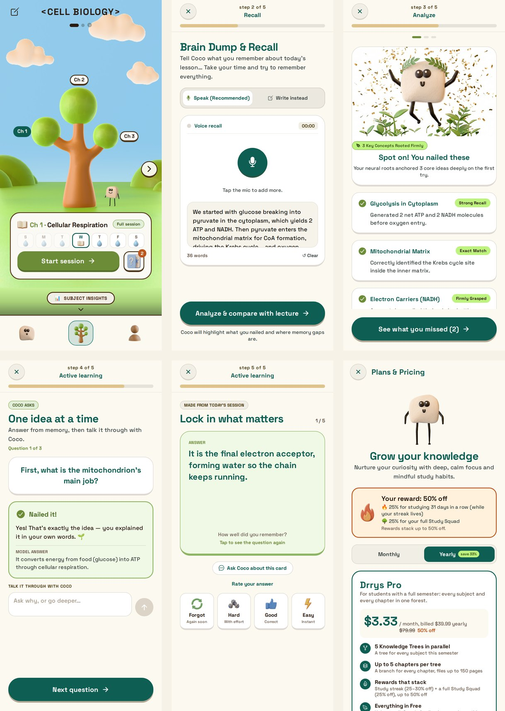

# Drrys: Grow what you know

Drrys turns studying into a small daily mission. Every subject is a tree, every chapter is a branch, and you keep your trees alive by watering them every day. The watering is a short study session with Coco, a little clay character who makes you study the way learning research says works, without you having to know any of the method names.

<sub>About the name: in spoken Arabic, *drrys* (درّيس) is someone who studies a lot.</sub>

Made by Yahya Al-Khayyat and Abdelhafeez Shaarawy. The `forgehacks` branch is our entry to **ForgeHacks Online 2026** (track **AI + Education**). This branch (`qloo`) builds on it for the **Qloo Agentic Hackathon**: see below for exactly what was added.



## ForgeHacks: what existed before, and what we built during it

**Before ForgeHacks (existing project):** the idea and visual identity, Coco, the trees and the whole Blender and Figma design work, the screens and the game around the tree (home, onboarding, the forest, profile), accounts and cloud backup, a first version of the study session, flashcards with spaced repetition (SM-2), streaks and reminders.

**Built during ForgeHacks (this branch):** the AI learning engine.

- A full session flow: choose the exact lecture pages, recall, AI analysis of what you remembered, missed and got wrong, a grouping step when many ideas were missed, active-learning questions, flashcards made from the gaps. You can go back a step safely.
- **Grounding:** every question and flashcard must come from the chosen lecture pages. The model must point to the page where the answer is written, and anything it cannot point to is dropped. The syllabus and past exams are used only to choose which ideas to ask and how to phrase them, never as a source of facts.
- **Question formats:** explain (graded by the AI), order, sort, match, work-it-out, and fill-in-the-blanks (in the app). The order, sort, match and blank formats are graded by plain code, not the model, with an "almost right" state. Gaps become flashcards.
- **Memory hooks:** on any flashcard or question the student writes their own hook (a story or picture), with ideas from Coco, and can ask for an AI picture of it (image model through the YouCam API). Hooks live on the tree: hold a branch to see them.
- Reading PDFs reliably on Android, sounds for right / wrong / half-right answers, XP shown as stars, and a simpler finish page that returns the student to the forest.

## Qloo Agentic Hackathon: what we added (after September 30)

Everything above existed before. On this branch we added **Qloo** to make Coco's teaching personal from the first minute: Coco explains hard ideas through the shows, music, teams and books each student loves.

- **"Show Coco your world" (new onboarding):** it goes from wide to deep. The student first picks the areas they're into (sports, movies, shows & anime, books, history) as big picture cards; for sports and history they then pick which ones (football, basketball, tennis, UFC, Formula 1 / Islamic history, Al-Andalus, Ancient Egypt, Greece, Rome…). Then they pick 3 or more things (teams, players, posters, figures) as big pictures with the name under them, from ready-made Arabic and global lists, with Qloo search for anything missing. The list learns as they pick: every pick brings three related things from Qloo's insights. History is our own list, because Qloo has no taste data for historical figures.
- **"Coco is exploring your world":** for each pick, Qloo finds what its fans also love (teams, shows, movies, books), and the themes (tags) of the student's whole world. The student sees the map grow, and can remove anything that isn't them.
- **The first explanation:** a famously hard idea from the student's own field (recursion for Computer Science, compound interest for Finance…), explained through their world. The analogy is written by the language model from the Qloo themes, and the card flips to the plain textbook version to show the difference.
- **Every session after that:** the student's world is passed to Coco, who uses it for an analogy when an idea is hard to picture.
- **A shorter, kinder onboarding:** field and speciality on one screen, a daily plan and promise (minutes, streak goal, reminder time), no sign-up until after the first session, one guided step on the tree, and a **sample lecture** so anyone (judges included) can try a full session.
- **Safe by design:** the Qloo key never ships in the app. Calls go through a Supabase Edge Function (`supabase/functions/qloo`) that only allows shows, movies, books, teams and athletes (no singers or actors), drops anything adult (17+/18+ ratings), romantic, or about alcohol, gambling or drugs, together with its picture (names, tags and age ratings are checked; no AI is used, so it stays fast and free), asks Qloo a few requests at a time to respect the rate limit, and caches results in memory. No Qloo data is stored in this repository. If Qloo can't be reached, the ready-made lists still work; only "more like this" and the exploring are skipped.

## Why we built it

Most students (us included) study by re-reading and highlighting. These methods are easy because they ask very little of your brain, and that's exactly the problem: without real mental effort, learning is slow, so you need many more hours to get a result. That's also what makes studying feel so boring and long.

Research says the opposite: to learn, your brain has to work. Recalling from memory, explaining ideas in your own words and spacing out your reviews are harder in the moment, but they make things stick much faster. Most students never hear about them, and they're hard to do alone.

Drrys puts these methods inside a short daily routine that feels like looking after a garden.

## A day with Drrys

After a lecture, the student opens the app. Their lecture files, syllabus and past exams are already there, so Coco knows the course.

**Lecture day: a full session (about 15 minutes)**

1. **Recall.** Tell Coco everything you remember from the lecture, by voice (Arabic, English and many other languages) or by typing. No notes.
2. **Gaps.** Coco compares what you said with the lecture file and shows what you nailed, what you forgot and what you got wrong.
3. **Explain.** Coco asks "why" and "how" questions on the parts you missed. You answer in your own words, Coco grades it, and you can argue back.
4. **Flashcards.** Cards are made from the lecture and from the exact things you got wrong in step 3.
5. Coco waters the tree.

**Other days: flashcards only**

The cards come back on a spaced repetition schedule (SM-2): forgotten cards come back the same day, easy ones after days or weeks.

Around that: a week view per subject, streaks, stats per tree, and daily reminders that know if you have a lecture session or cards waiting (and stay quiet on days you already studied).

## Built with

- Expo SDK 57, React Native, TypeScript, Expo Router
- A language model (Claude, or Gemini as a fallback) for reading the lecture pages, the analysis, questions, grading of explanations, flashcards and chat. Only the pages you studied are sent (`pdf-lib`). The model returns structured data that the app validates before showing it.
- YouCam API (text-to-image and image-to-image) for memory-hook pictures.
- Supabase for accounts, cloud backup and the squad/invite functions
- Zustand + AsyncStorage (works offline), Reanimated, expo-video, expo-audio, expo-notifications
- Coco, the trees, the world and the icons were modelled in Blender. Some animations were made with Flow from those renders, to save rendering time.
- Screens were designed in Figma with help from Stitch, and turned into the real app with Claude.

## Run it

```bash
npm install
cp .env.example .env   # add an AI key (Claude or Gemini), and optionally a YouCam key
npx expo start
```

- Qloo (server side): `npx supabase functions deploy qloo --no-verify-jwt`, then `npx supabase secrets set QLOO_API_KEY=your-key`.
- Without an AI key, Coco runs a built-in demo session so every screen can still be tried.
- Android APK: `npx eas-cli build -p android --profile preview`.

## Project layout

```
src/
  app/
    onboarding/     intro, questions, first tree, sign in, reminder
    (tabs)/         Coco, the forest, profile
    session/        choose file, recall, analyze, review, explain, flashcards, done
    subject.tsx     plant or edit a tree (chapters, files, syllabus, past exams)
  components/       UI kit, tree, video, voice
  lib/
    ai.ts           the AI client: prompts, grounding, question and card checks
    grade.ts        code-based grading (order, sort, match, blanks)
    youcam.ts       memory-hook pictures
    session.ts      page ranges, PDF reading
    cloud.ts        accounts and backup
    notify.ts       daily reminders
  store.ts          app state and the flashcard scheduler
```

## Known limits

- The AI key ships inside the build. For a real release the AI calls will move behind a server (a Supabase Edge Function).
- The app's screens are in English for now. Voice recall and Coco's chat already understand many languages, including Arabic.
- Android only so far.
- The AI memory-hook picture and some drag interactions were tested mainly in the browser; we are still testing them on more phones.
- Some features from the earlier version of the project (Pro plans, study squads, invites) exist in the code but are not part of this entry.

## What's next

Better memory hooks, AI-made videos and audio podcasts from your lectures, live AI chat with Coco, and a lot more.

## License

Copyright (C) 2026 Yahya Al-Khayyat and Abdelhafeez Shaarawy.

The code is open source under the [GNU AGPL v3.0](LICENSE): you can read, use and change it, but if you share, sell or run a changed version as a service, you have to publish your full source code under the same license.

The name "Drrys", the character Coco and the Drrys logo are our trademarks and are not covered by this license.
